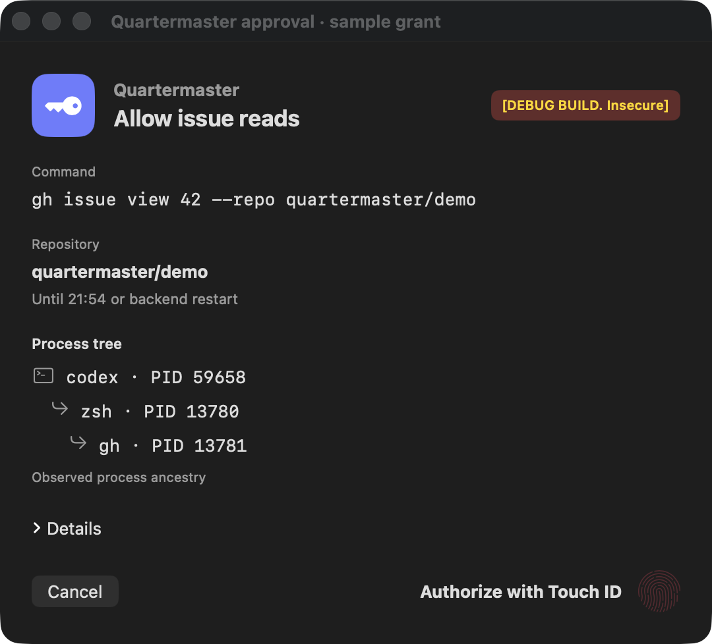
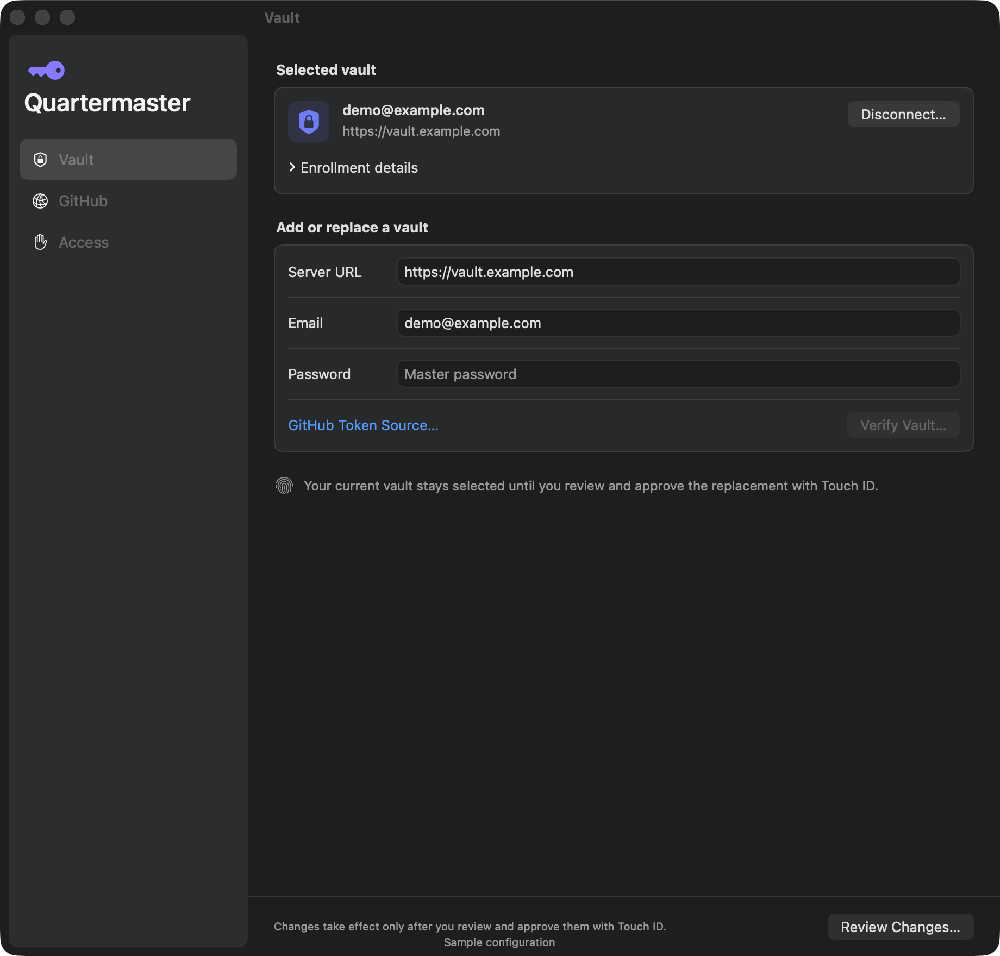

# Quartermaster: a developer-tooling focused credential provider.

Quartermaster is tool for macOS that manages access to credentials, focused on developer workflows, and giving tools scoped access to do what they need.

It is not a password manager and it does not store credentials itself; instead it delegates that responsibility to a purpose built tool, initially BitWarden or VaultWarden.

## Why this project exists

I had been using 1Password and `op`, particularly the plugin to integrate with GitHub's `gh` cli tool, meaning that access to the cli would require fingerprint auth once every 5-10 minutes, and no credentials were stored unencrypted on disk, which I generally liked.

However a few things mean I'm not happy with that approach anymore

Most importantly, 1Password has given money to the Omarchy project, and I cannot in good conscience use 1Password anymore now they fund Hate and right-wing views. If this is not an issue for you, this project is not for you.

Secondly the `op` tool was "all or nothing". Either you had credentials (or the 5 min cache was still valid) or you don't. I would like something that allows tools to read GH Issues of public repos without repeated prompts, but ask before closing one, or before reading issues on a private repo.

Thirdly, you don't get much context about what process is asking for credentials: "Ghostty wants to access the CLI"? Great, I've got 12 tabs, so which one am I actually allowing access? What else might get access once it's unlocked.

## So what does it do?

There are (or will be) two modes of operation.

The first mode is designed initially for the `gh` CLI tool, and it puts Quartermaster in the request flow between a tool and the service it talks to. QM intercepts and interprets API requests, applying your access rules to each request: allow it, require fingerprint approval, or deny it. Any request we can't understand the specific meaning of will still be presented for approval.

QM adds credentials when forwarding an authorized request to the service. The calling tool never receives them. Initially, this mode uses `gh`'s Unix-socket support.

The second mode supplies credentials directly to a tool. QM checks your access rules, asks for fingerprint approval when required, then launches the tool with the selected credentials in its environment.

The tool talks directly to the service. QM controls whether it receives the credentials; their upstream permissions determine what it can do afterwards.

## Current status

Quartermaster is an early prototype. The development app can enrol a Vaultwarden
account, unlock its encrypted cache with Touch ID, and mediate GitHub issue reads
for configured repositories. The broker also supports one-use approval and
request-preserving REST/GraphQL forwarding behind an explicit opt-in. That path
has automated local TLS coverage; live-provider and hardware acceptance remain.
Repository scope follows the requested name, as described in the
[GitHub guide](docs/github.md#repository-identity). Credential delivery through
environment variables is not implemented yet.





## Building and running

The current development target is Apple Silicon on macOS 26 with full Xcode.
Bazel is the build and test system. After [setting up the development tools](docs/development.md#build-and-check):

```sh
just build
just test
just check
```

`just build` produces an unsigned app at `bazel-bin/macos/Quartermaster.app`.
To run it with Touch ID, follow the [development signing and startup instructions](docs/development.md#sign-and-run).
Then use the native **Settings…** window and the [GitHub setup guide](docs/github.md)
to enrol a credential and configure mediated requests.

## Documentation

- [Development](docs/development.md): builds, signing, tests and troubleshooting.
- [GitHub setup](docs/github.md): enrolment, requests and read-access behaviour.
- [Architecture](docs/architecture.md): intended design and component ownership.
- [Security boundaries](docs/security-boundaries.md): authorization and credential protection.
