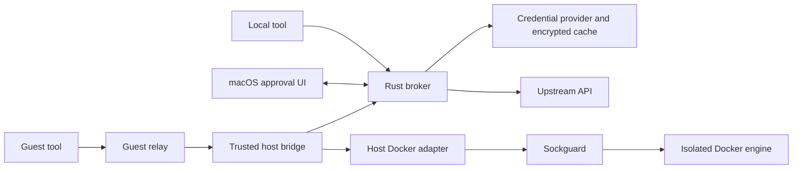

# Quartermaster architecture

This document describes component responsibilities and intended integrations.
[Security boundaries](security-boundaries.md) defines the required guarantees;
the [README](../README.md) describes what the current build supports.

## Access modes

In mediated mode, a tool sends requests through Quartermaster. The broker checks
the caller, request, destination and policy before obtaining credentials and
dispatching. A reusable grant can cover eligible requests; other operations need
their own approval. The caller receives the result, not the credential.

Credential handoff is the planned compatibility mode for other tools. The
broker authorizes release of a selected credential and launches the tool with
it in its environment. The tool then owns its API communication and has the
credential's upstream permissions. The release boundary is distinct from
mediated requests; see [credential handoff](security-boundaries.md#credential-handoff-planned).

Quartermaster governs the access routed through it. Applications using their own
credentials and network routes remain outside that boundary.

It runs in the logged-in user's GUI session without a root service or public
listener. Policy stays on the host, with no required Quartermaster cloud service.

## Native settings

The macOS app uses SwiftUI's Settings scene for Vaultwarden enrolment, the
GitHub repository catalogue, unfamiliar-request approval and recognized-mutation
rules. Edits remain a draft until a separate complete change review and an explicit
Save Changes action with Touch ID. Enrolment edits invalidate verification and
block review until reverified. Password entry is transient; vault snapshots, cache keys and selected
API credentials remain in Rust.

The backend persists signed settings and enrolment selection in a backend-only
Keychain record, with the enrolled approval-key pin in a separate protected item.
It verifies the stored signature against that pin before trusting settings after
restart. Cache slots contain encrypted
provider snapshots. Runtime grants are separate, memory-only authority and are
never restored from settings. See [settings authority](security-boundaries.md#settings-authority)
for the commit and cancellation boundary.

When a supported settings format needs migration, Settings explains the change
and offers the previous vault selection and rules for review. **Import and Trust**
uses the normal Touch ID approval flow; closing the review leaves the source
intact and inactive. Format decoders produce a versioned import candidate for
this common flow. They never publish migrated authority themselves. Existing
signed records remain usable without a new approval merely because the app restarts.

## Components

The diagram shows logical connections. Parsing untrusted protocols should be
isolated from credential-bearing code where practical; the broker still verifies
the request and facts on which authorization depends.

| Component | Responsibility |
|---|---|
| `qm-broker` | Verified callers, policy, grants, approvals, provider sessions and final dispatch. |
| `quartermasterd` | Process startup and service orchestration through the broker's public facade. |
| macOS UI | Status, enrolment, request presentation, OS authentication and protected approval signing. |
| Credential provider | Authentication, synchronization, decryption and selected-item access behind the owner. |
| API ingress and classifier | Bounded request capture and API-specific observations; neither supplies execution authority. |
| Host bridge | Host-selected VM/session binding, policy and bounded relay admission. |
| Guest relay | Byte transport and guest-local sockets. Guest claims do not establish host identity. |
| Docker adapter and Sockguard | Host path translation followed by Docker-specific authorization. |
| Secretive integration | Separately constrained SSH signing, with Secretive retaining its key and approval model. |

The [ownership contract](security-boundaries.md#component-ownership) defines which
authority and plaintext each component may hold. The credential owner's provider
and cryptographic interfaces remain private; executable orchestration uses its
public service facade.

## Requests and approvals

1. Authenticate the caller and capture a bounded request.
2. Establish the destination, credential selection, resource claims and effective
   policy from trusted host configuration and verified request facts.
3. Evaluate policy. A denial ends the operation; a valid grant may cover an
   eligible request. Otherwise obtain the required request-bound approval.
4. The UI presents the frozen request and signs its challenge after the required
   OS authentication. The backend verifies that proof independently.
5. Acquire the selected credential, recheck current authority, and serialize
   cancellation with final dispatch admission. Return the result to the caller.

For GitHub, recognized requests can produce specific descriptions and scoped
matches. Unfamiliar requests use complete request inspection and fresh approval,
subject to mandatory restrictions. They do not extend an existing grant. The
[GitHub contract](security-boundaries.md#github-requests-matching-and-approval-proposed)
defines request preservation, matching and approval. The development gateway
uses this flow; live-provider and hardware acceptance remain. Repository scope
follows the [requested repository name](github.md#repository-identity).

The UI may transfer its fresh authenticated `LAContext` to the backend over
authenticated XPC, allowing one fingerprint to unlock the cache and approve the
request. Cache unwrap and request approval remain separate operations: the
context carries no application-level approval. See the
[approval contract](security-boundaries.md#approve-what-the-user-can-understand).

The operation registry owns preparation, signing, cancellation and admission
phases. Each phase carries its required data. UI delivery and native context
leases do not maintain a second authorization state machine; execution adapters
consume registry-owned authority. Review and status models are typed, with JSON
at encoding boundaries.

## Policy

Policy evaluates verified principal, session, action, resource and context facts
and returns allow, deny or require approval. The broker retains protocol,
identity, cryptographic and final-admission checks regardless of policy language.
An unlocked provider does not create operation authority.

Keep the policy engine behind a small replaceable interface. Typed Rust/TOML,
embedded Rego and Cedar are candidates; no policy language or separate policy
service is required yet. Policy versioning and grant invalidation follow the
[authority lifecycle](security-boundaries.md#keep-authority-narrow-and-short-lived).

Sockguard owns Docker-aware policy. Quartermaster grants a session access to a
fixed host-selected profile; Sockguard decides whether each Engine request is
allowed. This keeps Docker enforcement in one place.

## Providers and offline cache

The initial provider uses `rbw` for Vaultwarden/Bitwarden protocol and crypto
behind Quartermaster-owned interfaces. Provider adapters may be replaced without
changing authorization semantics; a failure never silently selects another one.

Enrolment pins the server, authenticated account, selected item and field.
Vault edits happen through ordinary vault clients, followed by synchronization.
The cache is a disposable encrypted snapshot of the selected credential state.
Rust owns its device-bound Secure Enclave unwrap key; the UI has a separate
approval key and keychain group.

Offline use relies on the last synchronized state. The UI must show freshness;
host policy can require recent synchronization for sensitive operations. An
offline device cannot discover later upstream revocation. Reboot, provisioning
renewal and biometric changes need supported lifecycle handling before release.

The [cache-key decision](decisions/0001-rust-cache-key-ownership.md) explains key
ownership. The [snapshot decision](decisions/0003-vault-snapshot-and-refresh-state.md)
explains retained refresh state and rollback limits. Account/item verification
and redirected authentication follow the
[Vaultwarden redirect decision](decisions/0002-vaultwarden-redirects.md).

## Runtime and persistence

The macOS main thread runs a blocking native event loop with a registered wake
source. One Tokio runtime owns socket admission and provider futures; blocking
transport/storage work has bounded worker capacity. Native authentication
contexts remain on the peer's serial queue and authenticated connection
generation. Async work receives owned data and reply channels.

The authority mutex serializes authorization transitions. A separate cache
transaction lock covers preparation and publication, so filesystem work does not
block cancellation or authority checks. Publication admission checks the original
operation generation and source revision under the authority mutex; writes and
fsync happen outside it. Installation rechecks generation after the write.

Admission samples the kernel console generation, monotonic sleep/wake stamps
and login UUID alongside notification-driven revocation. These private macOS
properties need qualification on supported OS versions and can conservatively
revoke work on other console updates. UTC sync timestamps and shared macOS
monotonic samples have distinct types and clock lifetimes.

## API classifiers

Each API owns a self-contained analysis crate, starting with
[`qm-api-github`](../crates/qm-api-github/README.md). A future GitLab classifier
belongs alongside it with its own grammar, effects, resources, patterns and
limits. Shared machinery can be extracted when another implementation needs it.

The host-configured service selects an adapter and classifier. The adapter
translates typed observations for policy and presentation. Unfamiliar requests
stay with that service; they are not tried against other classifiers. A classifier
does not select credentials, confer authority or enable a service on its own.

The GitHub crate preserves captured bytes and reports coverage as well as known
observations. Complete positive matches must cover all effects; a recognized
sibling cannot hide unfamiliar input. The broker supplies its own pattern
catalogue and uses these observations for policy and approval. The classifier
remains independent of the daemon and credential authority.

## Caller attribution

The broker verifies the socket peer's running code through its kernel audit
token. Process ancestry is advisory context, with birth-time checks for observed
PID reuse. It cannot establish a particular script or attached terminal session.
When an ancestor cannot be fully inspected, the dialog shows its available name
and PID as limited information and explains where inspection stopped. Partial
observations never substitute for the socket peer's required identity checks.
The local approval dialog shows observed arguments independently of CLI syntax
or API classification. Quoting preserves argument boundaries and makes control
characters and invisible formatting explicit. Environment values are excluded;
observed commands are never logged or persisted. Arguments confer no authority.

A Nix wrapper using `exec` leaves the actual binary as the socket peer. The UI
may display `.gh-wrapped` as `gh` while retaining its real path and signature
in peer details. Such display aliases confer no authority.

## Client connections

The initial mediated CLI is `gh`, using HTTP over a Unix socket. Its logical
upstream origin and absolute URLs must remain bound to the configured service.
API-base replacement alone does not establish that subsequent requests stay on
the mediated route. Generic TLS interception is outside the initial transport.

`wiff` and `reviewq` need explicit client transport integration. Git fetch/push,
release tools and archive downloads can use different routes and require their
own adapters. A verified SSH signature establishes key use, not whether Git will
fetch or push or which repository it will affect.

Normal `gh` onboarding will show its `http_unix_socket` setting and offer to
apply it explicitly. Preserve preferences, aliases and credentials; disclose an
existing socket setting before replacing it. Managed configurations can be
changed at their source. Explain how to restore the previous setting and that
routed requests require Quartermaster to be running. The current development
setup uses an [isolated configuration](github.md).

## Guest and Docker services

The intended guest workflow uses ordinary Brig/Hull images and a static Linux
relay, with guest-local API, SSH and Docker sockets connected to a host-selected
session. The bridge binds
the VM generation and frozen policy; a socket path or guest-supplied process
label is not identity. Session status should show the VM, policy, credentials,
resources and expiry, with a direct revocation action.

Keep API/SSH and Docker carriers independent, with separate worker processes,
queues, capacity limits and revocation. A stalled consumer or failed stream must not block
unrelated work. Shared-folder sockets do not replace authenticated relay
admission.

Docker requests go through the host adapter and then the configured Sockguard
endpoint. The isolated engine retains build images and caches between sessions.
Session revocation stops new work and streams; it does not prune unrelated
resources or undo operations already sent. Engine egress is controlled separately
from guest egress.

Bind mounts cross guest, host-export and engine namespaces. Identical path
strings do not prove identical data. Initially, bind only stable, pre-provisioned
export roots. Supporting arbitrary child paths would require a trusted
engine-side resolver and leased staging mounts; a one-time `realpath` check
cannot prevent later replacement races.

CLI/Compose compatibility includes streaming, half-close and backpressure,
session-owned network metadata and explicitly permitted debug capabilities such
as `SYS_PTRACE`. Keep required owner-scoped protocol fields while redacting
sensitive environment and mount data. The
[service-isolation rules](security-boundaries.md#mediated-host-services) define
the admission, ownership, mount and port restrictions.
